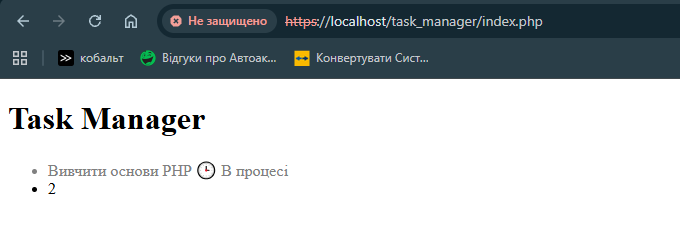
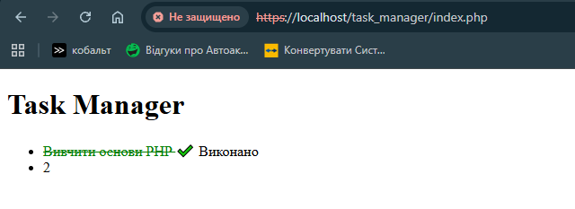

# Звіт до Лабораторної роботи №3

## Фрагмент коду

```
            <li class="<?= $isCompleted ? 'task-done' : 'task-pending' ?>">
                <?= $taskTitle ?>
                <?php if ($isCompleted == true): ?>
                    ✔️ Виконано
                <?php else: ?>
                    🕒 В процесі
                <?php endif; ?>
            </li>
```

## Результат виконання роботи




## Відповіді на контрольні запитання

**1. Які оператори порівняння існують у PHP (назвіть мінімум 4)?**
    $x == $y повертає true коли $x дорівнює $y
    $x != $y повертає true коли $x не дорівнює $y
    $x >= $y повертає true коли $x більше або дорівнює $y
    $x <= $y повертає true коли $x меньше або дорівнює $y

**2. У чому різниця між тотожним порівнянням (===) та звичайним прирівнюванням (==) у PHP? Наведіть приклад, де результати відрізнятимуться.**
    == порівнює операнди після їх автоматичного зведення, а  === порівнює і значення операндів, і тип даних та повертає true коли операнди належать до одного типу даних і мають однакові значення

**3. Для чого потрібен альтернативний синтаксис керуючих конструкцій (if (...): … endif;) під час роботи з HTML?**
    альтернативний синтаксис використовується для зручного поєднання PHP та HTML. Він робить код більш читабельним і дозволяє легко бачити початок та кінець умовного блоку (if  endif). У великих HTML шаблонах блоки коду розтягуються на десятки чи сотні рядків і в кінці сторінки дуже легко загубити чи додати зайву закриваючу дужку, при використанні endif такої проблеми немає

**4. Що таке тернарний оператор і який він має синтаксис? Коли його використання є недоцільним?**
    це скорочений запис простої конструкції if else, який дозволяє вибрати одне з 2 значень. 
    Синтаксис: 
    умова ? значення_якщо_true : значення_якщо_false;
    Недоцільно його використовувати в задачах зі складною умовою, де потрібно виконати багато команд. І тоді такий запис стаю дуже важко читабельним та незручним для розробника

**5. Які значення в PHP приводяться до false при перетворенні типів (type juggling) в умові if?**
    0, 0.0, "" - пустий рядок, "0" - рядок з нулем, [] - порожній масив, null 
