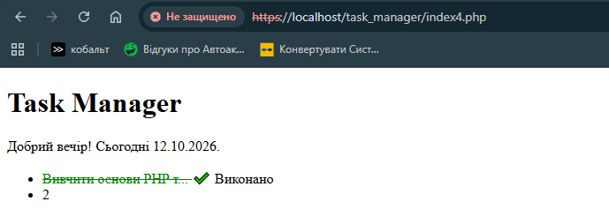

# Звіт до Лабораторної роботи №4

## Фрагмент коду

```php
function formatTitle($text, $maxLength = 20) {
    if (mb_strlen($text, 'UTF-8') > $maxLength) {
        return mb_substr($text, 0, $maxLength, 'UTF-8') . "...";
    }
    return $text;
}
function getCurrentGreeting() {
    $hour=date("H");
    if ($hour >= 6 && $hour <12) {
        return "Доброго ранку";
    } elseif ($hour >= 12 && $hour < 18) {
        return "Добрий день";
    } elseif ($hour >= 18 && $hour < 24) {
        return "Добрий вечір";
    }
    return "Доброї ночі";
}
function getCurrentDate() {
    return date("d.m.Y");
}
```

## Результат виконання роботи



## Відповіді на контрольні запитання

**1. Поясніть принцип “DRY” (Don’t Repeat Yourself) та як власні функції допомагають його дотримуватись**
Принцип DRY означає не повторюй себе, однаковий код не потрібно писати в декількох місцях. Повторювані дії виносяться в окрему функцію та викликаються там, де вони потрібні.

**2. Що таке аргументи функції та що таке параметри за замовчуванням? Наведіть приклад з коду.**
Аргументи - це значення, що передаються функції при її виклику, а параметри - це змінні в цій функції, які приймають значення. Параметр за замовчуванням має наперед задане значення, яке використовується, якщо відповідний аргумент не передали у функцію.
У функції formatTitle($text, $maxLength = 20) параметр $maxLength має значення за замовчуванням 20. Під час виклику formatTitle($taskTitle) назва завдання передається в параметр $text, а межа скорочення становить 20 символів

**3. Що станеться, якщо у функції не написати конструкцію return, але спробувати присвоїти результат її виклику в змінну x ($x = myFunc())? Яке значення буде в $x?**
Без return функція просто мовчки завершує роботу і автоматично повертає null. 

**4. Що таке “область видимості” (scope) змінної? Чи можна у тілі функції звернутись до $taskTitle, створеної за межами цієї функції, без ключового слова global?**
Область видимості - зона діх змінної. А точніше контекст у коді, в якому вона оголошена, існує і до якої можна звернутися.
Глобальні - створені поза будь якими функціями, доступні у всьому скрипті, але не всередині функцій.
Локальні - створені всередині функції, доступні лише всередині цієї функції і зникають одразу після її виконання.
У тілі функції звернутись до $taskTitle, створеної за межами цієї функції, не можна. Якщо так зробити без global, функція створе локальну змінну з такою самою назвою та значенням null.

**5. Для чого призначена вбудована функція substr() і які вона умовно приймає аргументи?**

Функція substr() призначена для вирізання частини рядка з основного тексту по заданій позиції та довжині. Вона приймає 2 обов'язкових аругменти. 
$string - вхідний рядок з якого треба вирізати частину та $offset - початкова позиція, з якої починається вирізання.
