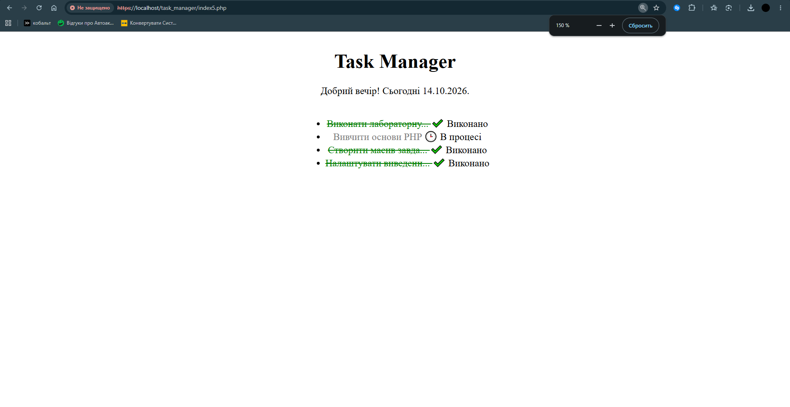

# Звіт до Лабораторної роботи №5

## Масив $tasks

```php
$tasks = [
    [
        'id' => 1,
        'title' => 'Виконати лабораторну роботу №5',
        'priority' => 'High',
        'is_completed' => true
    ],
    [
        'id' => 2,
        'title' => "Вивчити основи PHP",
        'priority' => 'Medium',
        'is_completed' => false
    ],
    [
        'id' => 3,
        'title' => "Створити масив завдань",
        'priority' => 'High',
        'is_completed' => true
    ],
    [
        'id' => 4,
        'title' => "Налаштувати виведення через цикли",
        'priority' => 'Low',
        'is_completed' => true
    ],
];
```

## Цикл foreach

```php
<main>
        <ul>
            <?php foreach ($tasks as $task): ?>
                <li>
                    <span class="<?= $task['is_completed'] ? 'task-done' : 'task-pending' ?>">
                    <?= formatTitle($task['title']) ?>
                    </span>
                    <?php if ($task['is_completed'] == true): ?>
                        ✔️ Виконано
                    <?php else: ?>
                        🕒 В процесі
                    <?php endif; ?>
                </li>
            <?php endforeach; ?>
        </ul>
    </main>
```

## Результат виконання роботи



## Відповіді на контрольні запитання

**1. В чому принципова різниця між індексованими та асоціативними масивами в PHP? Наведіть фрагменти коду з прикладами.**
Асоціативні масиви використовують рядкові імена, які розробник задає самостійно. Наприклад: 
$tasks = [
        'id' => 1,
        'title' => 'Виконати лабораторну роботу №5',
        'priority' => 'High',
        'is_completed' => true
]; 
echo $tasks['title']; Виведе - Виконати лабораторну роботу №5.

А індексовані масиви використовують індекси для доступу до елементів. Наприклад:
$tasks2 = ['Ліво', 'Центре', 'Право'];
echo $tasks2[0]; Виведе - Ліво
echo $tasks2[1]; Виведе - Центра
echo $tasks2[2]; Виведе - Право

**2. Які ключові компоненти містить цикл foreach? Чому його використання для масивів є кращим за цикл for?**
Ключові компоненти foreach: Масив, який перебирається циклом; Тіло циклу та тимчасова змінна.
foreach кращий за for, тому що автоматично перебирає всі елементи масиву, не потребує лічильника та підходить як для індексованих, так і для асоціативних масивів.

**3. Що буде, якщо у foreach звернутися до ключа, якого не існує в асоціативному масиві (наприклад, $task['deadline'])?**
Цикл не зупиниться, але відасть помилку Undefined array key та значення неіснуючого ключа стане Null.

**4. Для чого ми використовуємо альтернативний синтаксис endforeach; замість фігурних дужок } в HTML-шаблонах?**
Завдяки foreach і endforeach чітко видно початок і кінець циклу. При великих циклах з дужками } важче працювати і набагато простіше допустити помилку із закриттям і відкриттям циклу.

**5. Наведіть мінімум 3 приклади корисних вбудованих функцій PHP для роботи з масивами (наприклад, для кількості, сортування тощо) та коротко опишіть їх.**
in_array($value, $array) - перевіряє наявність значення value в массиві array і повертає true або false
array_merge($array1, $array2) - об'єднує масиви, значення масива2 перезаписує на масив1, а нові змінні додає в кінець
count($array) - підраховує кількість елементів у масиві