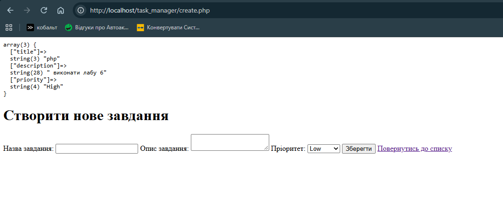
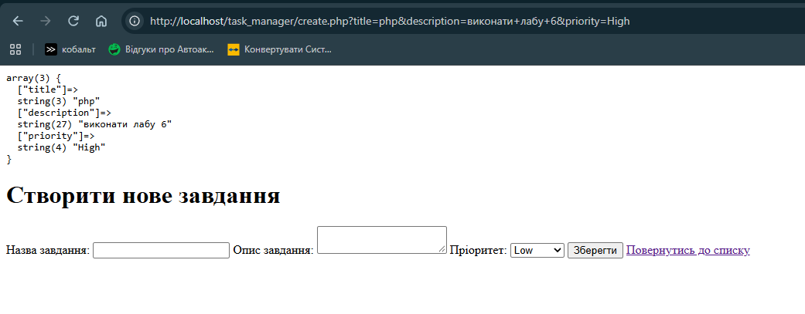

# Звіт до Лабораторної роботи №6

## Блок коду з формою

```php
<body>
    <h1>Створити нове завдання</h1>
    <form action="create.php" method="POST">
        <label for="title">Назва завдання:</label>
        <input type="text" id="title" name="title">

        <label for="description">Опис завдання:</label>
        <textarea id="description" name="description"></textarea>

        <label for="title">Пріоритет:</label>
        <select id="priority" name="priority">
            <option value="Low">Low</option>
            <option value="Medium">Medium</option>
            <option value="High">High</option>
        </select>

        <button type="submit">Зберегти</button>
        <a href="index6.php">Повернутись до списку</a>
    </form>
</body>
```

## Метод POST


## Метод GET


## Відповіді на контрольні запитання

**1. Назвіть 3 ключові відмінності між HTTP-методами GET та POST під час передачі даних з форми.**
1: GET тільки для читання та не змінює дані на сервері, POST - для збереження нових сутностей у БД, зміни існуючих або виконання дій, що змінюють стан сервера
2: GET прикріплює всі нові параметри відкрито прямо в URL, POST - дані заховані в тіло запиту.
3: GET не може вставити фото або багато тексту, POST може віпраавляти гігабайти інформації або такі файли, як фото та документи

**2. Вкажіть, в яких ситуаціях передача даних методом GET (відкритим текстом в URL) є прийнятною, і чому не можна передавати таким чином паролі.**
GET є прийнятним, наприклад, для фільтрації та сортування товарів у каталозі.
Оскільки параметри потрапляють у URL, вони відображаються на екрані відкритим текстом, залишаються в історії браузера та записуються відкритим текстом в access-логи сервера.

**3. За що відповідає HTML-атрибут action у тегу <form>?**
action вказує шлях до файлу, куда будуть відправлені дані форми після наисканя кнопки відправки користувачем.

**4. За яким критерієм PHP асоціюватиме дані з форми з ключами у масиві $_POST (які HTML атрибути тут вирішальні)?**
name - назва ключа в масиві $_POST
value - введений користувачем текст
method - метод передачі даних 
атрибут name - вирішальний, без нього браузер просто проігнорує елемент форми і не віпрдавить його на сервер

**5. Назвіть призначення функції var_dump() та тегу <pre>. Чи використовується цей код у продуктовому (Production) середовищі для реальних клієнтів?**
var_dump() виводить детальну інформацію про змінну - її тип, значення та структуру. Тег <pre> робе функцію var_dump() більш читабельною, зберігаю форматування тексту, пробілів та переносів. 
Цей код не використовується у прод середовищі, бо він показує напряму внутрішню структуру та конфіденційні дані, використовують тільки під час розробки або тестування сайту.
